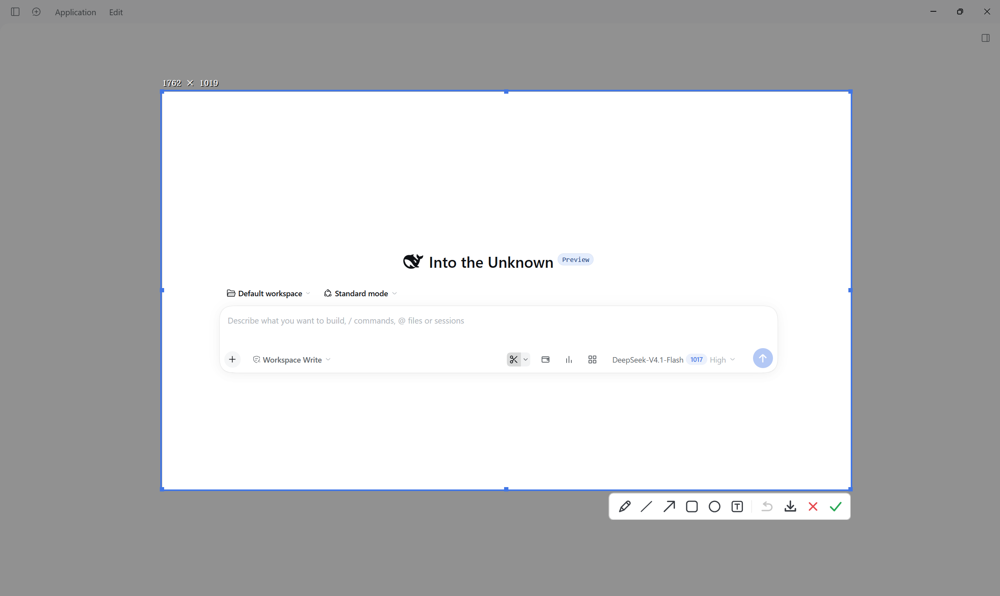
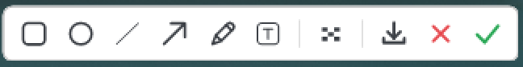

# DSH 内置截图工具 v2

给 DeepSeek Harness 的原生截图工具 v2：窗口/屏幕/任务栏自动识别高亮、手动框选、图形/画笔/文本标注、马赛克、取色，确认后图片填入 DSH 输入区（不自动发送）。入口左键＝保留 DSH 窗口、右键＝最小化 DSH 窗口。


[English](README.en.md) | 中文


> *注：示意图为 v2.1 实际界面——鼠标悬停的候选选区（稍粗蓝色边框 + 左上角尺寸标签）、区域外暗化，以及底部的纯图标工具栏。*

## 特性 (R1–R30)

| 特性 | 说明 |
|---|---|
| 入口剪刀按钮（左键/右键） | 话筒按钮左侧新增剪刀图标，同容器紧邻话筒之前，尺寸/圆角/hover 风格一致；**左键进入＝不隐藏 DSH，右键进入＝最小化 DSH**，悬停提示写明两种用法，右键时浏览器菜单被阻止 (R1, R2, R2a) |
| 自动识别目标 | 鼠标移动自动高亮窗口、桌面完整屏幕、任务栏；蓝色边框 + 白底尺寸标签（如 `888×777`）+ 区域外暗化 (R6, R8, R9) |
| 单击与框选 | 单击直接确认识别区域进入编辑；按住拖动自由框选，松开即确认 (R10, R11) |
| 无开关栏、无设置文件 | v2.1 删除了顶部「隐藏 DSH 窗口 / 长截图」开关栏与 `settings.json` 持久化：截图界面内没有第二个隐藏入口 (R3, R13) |
| 统一编辑器 | 所有截图进入同一编辑器：图形（矩形/椭圆/直线）、箭头、画笔、文本（支持粗细/颜色），中间马赛克 (R18, R20, R21) |
| 保存 / 取消 / 确定 | 右侧三键：保存 PNG、红叉取消、绿勾确定 (R22, R24) |
| 注入输入区且绝不自动发送 | 确定后图片经由合成粘贴事件注入 DSH 会话输入区，代码绝不触发发送操作 (R23) |
| 快捷取消 | 选区外单击鼠标右键或按 Esc 即可退出截图模式 (R4, R17) |
| 按需启动 + 30 秒余温 | 页面加载不预热，**点剪刀才启动** `SnipTool.exe`（运行 `%LOCALAPPDATA%\dsh-screenshot\<哈希>` 下的副本，不占用 node_modules）；一次截图结束后（确定/取消/右键退出）进程只多活 **30 秒**就自行消失——30 秒内再截一张走管道唤醒、秒开；空闲超时后机器上没有任何截图进程 (R27) |
| 语言与主题跟随 | 自动跟随 DSH 中/英文语言偏好与明/暗主题 (R28) |
| 纯本地与零遥测 | 原生 .NET Framework 4.8 / GDI+ 实现，纯本地运行，无网络请求、无遥测 (R26, R29) |


> *注：示意图为 v2.1 工具栏：矩形、椭圆、直线、箭头、画笔、文本、马赛克 ｜ 保存、取消（红叉）、确定（绿勾）；撤销用 `Ctrl+Z`。*

## 安装

需要 Windows 10/11 和 DeepSeek Harness。不需要管理员权限，也不需要额外运行库。

1. 把仓库放到插件目录，例如 `D:\dsh-home\plugins\dsh-screenshot`。

2. 在 DSH profile（`<DSH_HOME>/profiles/<name>/package.json`）里加入 bundle 与链接：

   ```json
   {
     "dsh": {
       "profile": {
         "bundles": ["@deepseek-ai/dsh-base", "@deepseek-ai/dsh-web-app", "dsh-screenshot"]
       }
     },
     "dependencies": {
       "dsh-screenshot": "link:D:/dsh-home/plugins/dsh-screenshot"
     }
   }
   ```

3. 启动 DSH，语音输入话筒左侧即会出现剪刀截图按钮：

   
   > *注：示意图为 v1 按钮样式；v2 剪刀按钮紧邻话筒左侧（同一容器），移除了旧的选项箭头菜单。*

## 快捷键与操作

| 操作 | 效果 |
|---|---|
| 左键点击剪刀按钮 | 进入截图覆盖层，DSH 窗口保持原样（不隐藏） |
| 右键点击剪刀按钮 | 进入截图覆盖层并最小化 DSH，退出/完成后自动恢复 |
| 单击 | 确认自动识别的窗口/屏幕/任务栏区域 |
| 拖拽鼠标 | 手动框选矩形区域 |
| 拖动控制点 | 调整选区尺寸 |
| `Ctrl+Z` | 撤销上一笔标注 |
| `C` 或 `Ctrl+C` | 复制指针处色号（`#RRGGBB`） |
| 回车 或 `✓` | 确定并将截图注入 DSH 输入区（不自动发送） |
| `Esc`、鼠标右键、`✕` | 取消截图并恢复 DSH 窗口 |

## 架构

- **Host (lib/index.js)**: Cordis 插件服务，声明 `inject = ['webServer']`，管理暖进程（`SnipTool.exe --serve --parent <pid>`）与 `/shot/api/capture`、`/shot/api/last`、`/shot/api/probe` 等路由（`/shot/api/probe` 默认关闭；`touch %TEMP%\dsh-shot-debug.on` 后刷新页面，POST `/shot/api/probe` 才会把前端诊断 JSON 写到 `%TEMP%\dsh-shot-probe.json`），透传语言与主题，并按本次点击传 `hide=1|0`（左键 0、右键 1）。
- **Client (lib/client.js)**: 前端注入剪刀按钮到话筒左侧，移除旧选项菜单；截图完成后通过合成 paste 事件注入 composer，绝不自动发送；中英双语可读错误处理。
- **Native (bin/SnipTool.exe)**: C# 原生覆盖层，实现窗口/任务栏/屏幕探测、统一编辑工具栏（v2.1 无长截图、无设置文件）。
